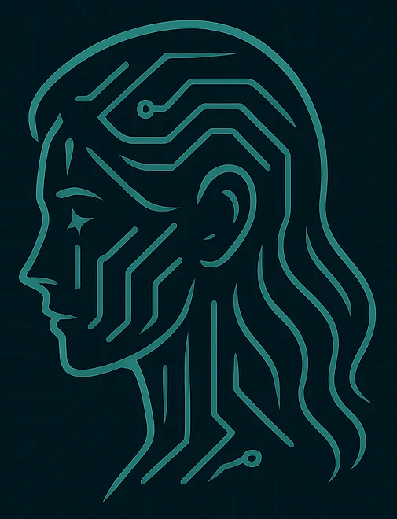

<div align="center">

</div>

# Identidad visual de ANIMA

Todo el material de esta carpeta se deriva del arte oficial que ya consume la PWA. Aquí están
las versiones optimizadas para documentación; los originales que sirve la aplicación viven en
`anima-ollama-tft/server/static/`.

## Símbolo

Un perfil femenino trazado con líneas de circuito sobre fondo casi negro. Las líneas sugieren
tanto un rostro como una placa base: la idea es una mente sintética con presencia humana. No se
recolorea, no se estira y no se le añaden efectos.

Para el **modo conversación** existe una variante frontal (`anima-face.webp`), generada a partir
del mismo lenguaje visual: rostro simétrico, mirada directa y las mismas líneas de circuito. Se
usa dentro del portal circular, recortada en círculo y sobre fondo oscuro. El perfil y el frontal
no deben mezclarse en la misma composición.

| Archivo | Tamaño | Uso |
|---|---|---|
| [`anima-banner.png`](anima-banner.png) | 1600×400 | Cabecera de README (raíz y repos) |
| [`anima-mark-compact.png`](anima-mark-compact.png) | 200×254 | Cabecera de README de subproyecto |
| [`anima-icon-256.png`](anima-icon-256.png) | 256×256 | Avatar de repositorio, redes, favicon grande |
| [`arquitectura.png`](arquitectura.png) | 1600×880 | Diagrama de arquitectura del README raíz |

Los originales, tal como los sirve la app:

| Archivo | Ruta |
|---|---|
| Marca completa (símbolo + palabra) | `anima-ollama-tft/server/static/branding/anima-mark.webp` |
| Rostro frontal (modo conversación) | `anima-ollama-tft/server/static/branding/anima-face.webp` |
| Fondo de pantalla | `anima-ollama-tft/server/static/branding/anima-wallpaper.webp` |
| Iconos PWA 180 / 192 / 512 | `anima-ollama-tft/server/static/icons/` |

## Paleta

Extraída directamente de `static/index.html` y del fondo de pantalla, no inventada:

| Color | Hex | Dónde se usa |
|---|---|---|
| Fondo profundo | `#00151c` | Fondo de la app, banners, diagramas |
| Panel | `#052027` | Superficies elevadas y burbujas del asistente |
| Turquesa de marca | `#35e6ce` | Acento principal, líneas del símbolo, foco |
| Menta | `#9af7e9` | Texto destacado, títulos del diagrama |
| Texto | `#e8fffb` | Texto principal |
| Apagado | `#7fa8a4` | Texto secundario |
| Peligro | `#ff7185` | Errores y estado de grabación |

El tema es oscuro por decisión de diseño: el asistente vive en una pantalla pequeña y en una TFT
de 1,8", donde un fondo oscuro reduce el cansancio y hace que el turquesa destaque sin esfuerzo.

## Tipografía

- **Interfaz:** `Inter`, con la pila del sistema como respaldo (`ui-sans-serif`, `system-ui`).
- **Diagramas y documentación técnica:** `DejaVu Sans` / `DejaVu Sans Mono`, que es lo que hay
  disponible en el sistema donde se generan las imágenes.

## Regenerar el diagrama

```bash
python3 docs/branding/make-diagram.py
```

El script dibuja con Pillow usando esta misma paleta y avisa si algún texto se sale de su caja.
Si cambias textos o añades un servicio, edita el script en lugar de retocar el PNG a mano: así el
diagrama sigue siendo reproducible.

## Convenciones para los README

- El banner va a ancho completo, sin sombras ni marcos añadidos.
- Los iconos de cabecera de subproyecto usan `anima-mark-compact.png` a 110–120 px.
- Las insignias (badges) se pintan con `labelColor=00151c` y el color de marca en el texto, para
  que no rompan la armonía del encabezado.
